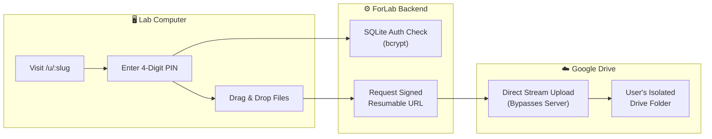

# ForLab 🧪

> **Zero-login file & code drop portal for shared lab PCs.**  
> Drop files and code snippets straight into your personal Google Drive from any public computer — without ever logging into Google or exposing your personal account.

---

## ⚡ The Problem

When working on shared computers (university labs, research stations, library PCs, kiosk terminals), getting your work onto your personal machine usually means:
* **Logging into your personal Google / Dropbox account** on a public computer with keyloggers or saved sessions.
* **Emailing attachments to yourself** (slow, file size limits, requires opening your inbox).
* **Using USB drives** (security-blocked ports, malware risks, or you forgot your drive).

**ForLab solves this:** Open your personal drop link (`forlab.app/u/yourname`) $\rightarrow$ type a 4-digit PIN $\rightarrow$ drag & drop your files $\rightarrow$ they land in your Google Drive instantly. **Zero Google credentials on the shared machine.**

---

## ✨ Features

- **🚀 Direct Resumable Uploads (No File Size Limits):** Files stream directly from your browser to Google Drive servers via resumable upload sessions — bypasses serverless payload limits. Drop hundreds of MBs seamlessly.
- **🔒 Zero-Login Lab Access:** Users unlock access with a personal 4-6 digit PIN. No Google OAuth or password prompts on the public PC.
- **📂 Isolated User Folders:** Each user connects their own designated Google Drive folder. Files are sandboxed to that folder.
- **📝 Code Snippet Editor:** Built-in code drop editor supporting C++, Python, Java, JavaScript, and plaintext with automatic language-specific naming.
- **📲 Instant Share & QR Codes:** Generates instant Google Drive links and a scannable QR code on upload completion for mobile pickup.
- **💾 Embedded SQLite Database:** Self-contained user accounts, bcrypt-hashed PINs, and HMAC-signed session tokens in a local SQLite file (`forlab.db`).
- **🛡️ Admin Console:** Built-in management panel to view registered users, test folder connectivity, and reset forgotten PINs.

---

## 🛠️ Tech Stack

- **Frontend:** React 19, Vite 8, Lucide Icons, QRCode.react
- **Backend API:** Node.js, Express (local server) / Vercel Serverless Functions
- **Database:** SQLite via `@libsql/client` (embedded, zero cloud DB dependencies required)
- **Security:** `bcryptjs` password hashing, HMAC-SHA256 session tokens
- **Cloud Storage:** Google Drive API v3 (Direct resumable upload + Service Account / OAuth sync agent)

---

## 🚀 Getting Started

### 1. Prerequisites
- [Node.js](https://nodejs.org/) (v18+)
- A Google Cloud Project with the **Google Drive API** enabled.

### 2. Installation
```bash
git clone https://github.com/your-username/forlab.git
cd forlab
npm install
```

### 3. Environment Configuration
Copy the template and fill in your keys:
```bash
cp .env.example .env
```

Inside `.env`:
```env
# Master passcode for admin access
MASTER_KEY=your_admin_passcode

# Google OAuth2 Credentials (sync agent)
GOOGLE_CLIENT_ID=your_client_id.apps.googleusercontent.com
GOOGLE_CLIENT_SECRET=your_client_secret
GOOGLE_REFRESH_TOKEN=your_refresh_token_with_drive_scope

# Optional: Service Account fallback
GOOGLE_SERVICE_ACCOUNT_EMAIL=your-sa@project.iam.gserviceaccount.com
GOOGLE_PRIVATE_KEY=your_base64_encoded_private_key
```

### 4. Run Locally
Start the API server (Port 3001) and Vite client (Port 5173):
```bash
# Terminal 1: Backend API
npm run dev

# Terminal 2: Frontend App
npm run client
```

Visit `http://localhost:5173` in your browser.

---

## 📖 How It Works



---

## 🔐 Security & Privacy

1. **No Plaintext Passwords:** User PINs are hashed using `bcrypt` before storing in SQLite.
2. **Folder Sandboxing:** Users share only one specific folder with the sync bot as Editor. The bot has zero access to the rest of the user's Google Drive.
3. **No Local Traces:** Closing the browser tab on the lab computer leaves no persistent login session.

---

## 📄 License
MIT License. Free to use, modify, and self-host for your lab, school, or team.
